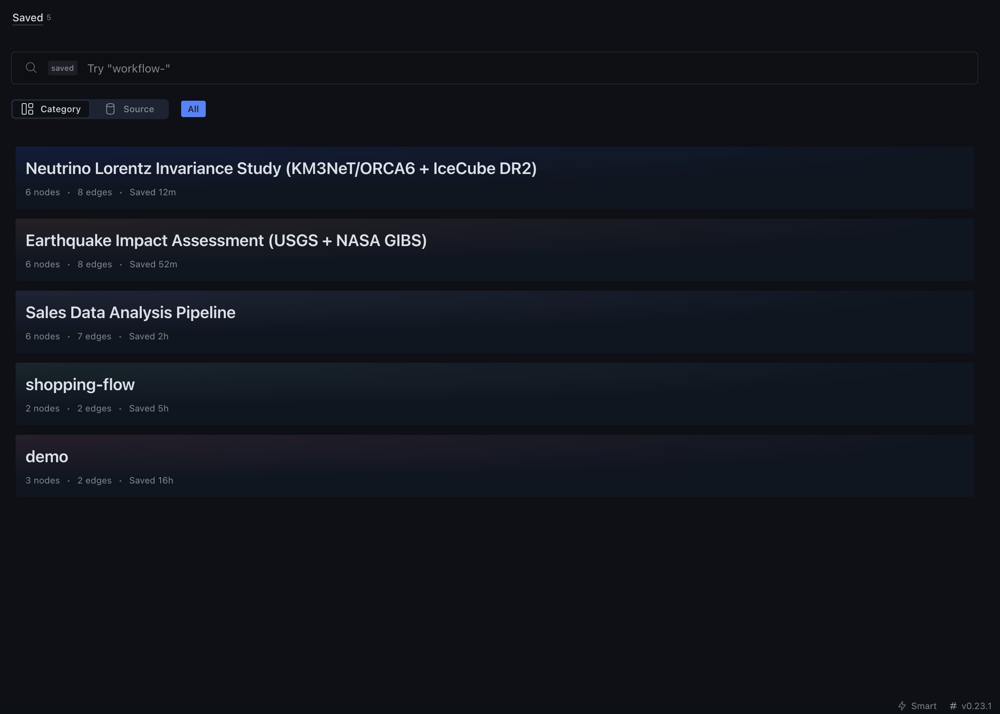
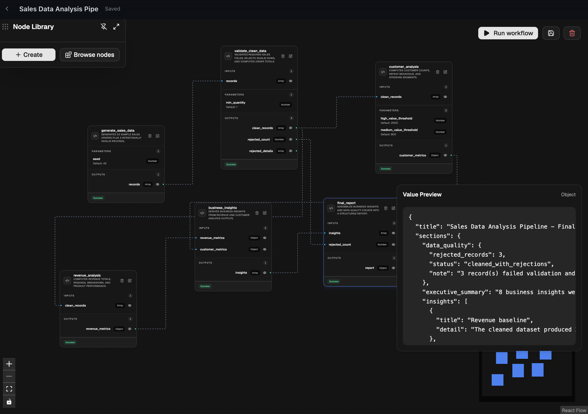
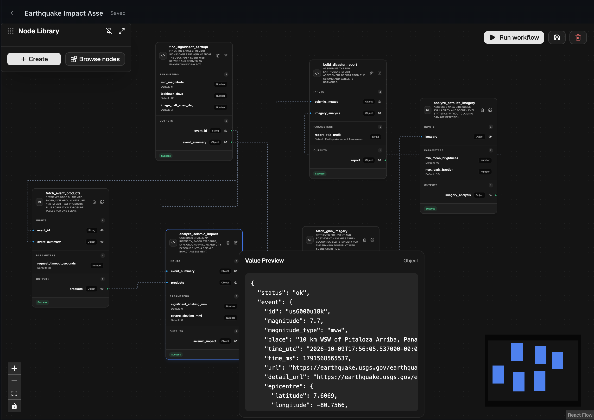
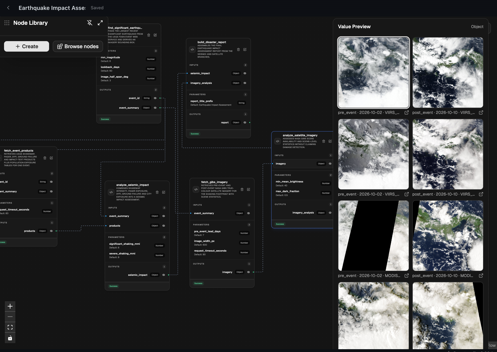
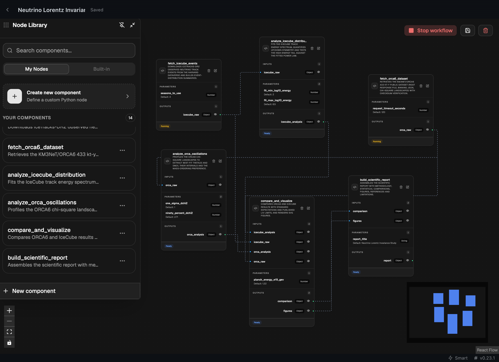
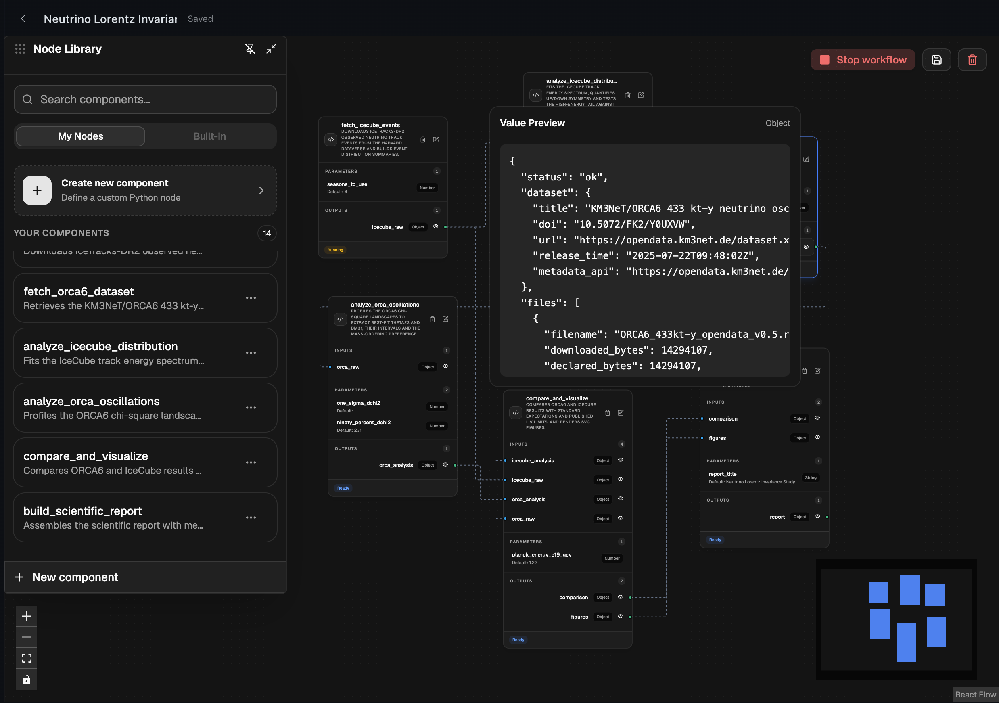

# Workflow Studio

Workflow Studio is a general-purpose, agent-based workflow platform for building and executing workflows for any task. Describe what you want to accomplish, and Hermes can create the workflow by configuring components, connecting their inputs and outputs, and organizing them into an executable graph.

Complex tasks often involve multiple steps, dependencies, and parallel operations. Workflow Studio provides a visual node-based editor where you can inspect, modify, and manage workflows, with support for reusable components, custom code, typed connections, and conditional execution.

---

> **Beta:** Workflow Studio is currently in beta and is available on macOS only. Support for other platforms will be available in upcoming updates.

---

## Showcase

Explore workflows built and executed with Hermes Workflow Studio. Each showcase includes screenshots, the original prompt, and the workflow JSON to import and run.

### Workflow Library

Browse and manage saved workflows.



### 1. Sales Data Analysis Pipeline

A complete data analysis pipeline that generates sample sales records, validates and cleans data, performs parallel revenue and customer analysis, and combines the results into a final business report.



- [Workflow JSON](./demo/SalesDataAnalysisPipeline/workflow-8bc98c2b-537c-46e0-b5db-d2bf5c6a13d0.json)
- [View Prompt](./demo/prompts.md#sales-data-analysis-pipeline)

---

### 2. Earthquake Impact Assessment

A real-world disaster assessment workflow combining USGS earthquake data and NASA satellite imagery to analyze seismic activity, geographic exposure, and available impact estimates.




- [Workflow JSON](./demo/EarthquakeImpactAssessment/workflow-77d62f4c-f512-409f-bf5d-be010ea310c0.json)
- [View Prompt](./demo/prompts.md#earthquake-impact-assessment)

---

### 3. Neutrino Oscillations & Lorentz Invariance Analysis

A scientific research workflow comparing publicly available KM3NeT and IceCube neutrino datasets through parallel analysis branches, combining experimental findings into a structured research report.




- [Workflow JSON](./demo/NeutrinoLorentzInvarianceStudy/workflow-0b7c316b-f86f-47bd-8661-ed391b12e774.json)
- [View Prompt](./demo/prompts.md#neutrino-oscillations--lorentz-invariance-a-comparative-km3net-and-icecube-analysis)

---

##### Warning 
> Applications limited to user's imaginations.

---

## Getting Started

### Installation

```bash
hermes plugins install hermes-workflow
```

After installation, enable the plugin using Hermes's plugin management interface or CLI.

### First workflow

Once the plugin is installed and enabled:

1. Open Workflow Studio in Hermes Desktop.
2. Create a new workflow or ask Hermes to create one.
3. Add nodes to the graph.
4. Configure node inputs, outputs, parameters, and Python execution logic.
5. Connect compatible ports.
6. Save the workflow.
7. Execute it from Workflow Studio or ask Hermes to run the saved workflow.

For example, you can ask Hermes:

> Build a disaster-response workflow that analyzes incoming satellite imagery, detects damaged infrastructure and blocked roads, identifies affected populations, and prioritizes emergency response locations. Combine the findings to generate a response plan with resource allocation and recommended rescue routes. Save the workflow and execute it.

Hermes can use the registered workflow tools to construct the graph.

---

## Security and Important Disclosures

Workflow Studio is a development-oriented workflow execution environment. Users should understand how node execution works before running workflows.

### Python code execution

Workflow nodes contain Python source code that is compiled and executed by the plugin-host backend.

The backend uses Python's `compile()` and `exec()` to load the node's `Execution` class and invokes its `build_output()` method.

**This is not a Python sandbox.**

The execution endpoint does not currently provide an isolated operating-system process or container for each node. Python code executes within the plugin backend's runtime environment and may have access to capabilities available to that process.

Only run workflows and node definitions from sources you trust. Do not execute untrusted Python code.

### Network access

Node execution code can use network capabilities available to its Python runtime. Node authors should disclose and explain any external services their nodes contact.

### Data and persistence

Workflow and reusable node definitions are stored through the plugin's storage layer. They persist independently of the active editor session.

Node execution receives the connected upstream outputs as inputs. The plugin's execution endpoint currently passes empty parameter and context dictionaries to the node implementation.

### Credentials

Do not hardcode API keys, passwords, access tokens, or other secrets into node source code or workflow definitions.

Any node that requires external credentials should use an appropriate secure credential integration.

### Background execution

The workflow execution request is dispatched through Hermes Desktop events. The current implementation does not provide a separate durable background execution service.

---

## Compatibility

Workflow Studio requires Hermes Agent `0.23.0` or newer.

---

## Contributing

Contributions, bug reports, and feature suggestions are welcome.
Please open an issue or pull request in the repository:

https://github.com/SaM-0777/hermes-workflows

---

## License

This project is licensed under the MIT License